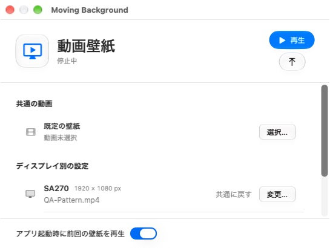

# Moving Background

[English](README.md) · [日本語](docs/README.ja.md) · [繁體中文](docs/README.zh-Hant.md)

Turn a local MP4 into a silent, looping desktop wallpaper on macOS or Windows. On Mac, assign a different video to each display and pause playback automatically when the desktop is hidden.

[Download from GitHub Releases](https://github.com/Hamzimer/MP4-Moving-Background/releases/latest)

## Features

| | macOS | Windows preview |
| --- | --- | --- |
| Controls | Menu bar and settings window | Notification area |
| Displays | Set a default video and override it per display | Primary display |
| Playback | Silent loop; pauses when the desktop is hidden, the display sleeps, the session is inactive or Low Power Mode is on | Silent loop; pauses while another app has focus or the session is locked |
| Languages | English, Japanese and Traditional Chinese | English, Japanese and Traditional Chinese |

On Mac, choose **Language** at the bottom of Settings. Changes take effect immediately and are saved. **System Default** follows macOS. Windows follows the system display language. Your MP4 stays in its original location.

## Install

- **macOS 26 or later, Apple Silicon or Intel** — Open the [DMG](dist/Moving-Background-macOS.dmg?raw=true), drag Moving Background to Applications, then select an MP4 in Settings. This build has an ad hoc signature and is awaiting Apple notarization.
- **Windows 10 or 11 x64** — Install the [Windows MSI](https://github.com/Hamzimer/MP4-Moving-Background/releases/latest/download/Moving-Background-Windows-x64.msi). Then open Moving Background from the Start menu and choose an MP4 in the notification area. This unsigned preview requires .NET Framework 4.8. If you installed the previous EXE-based preview, uninstall it from Windows Settings first.

[SHA-256 checksums](https://github.com/Hamzimer/MP4-Moving-Background/releases/latest/download/SHA256SUMS.txt) · [Report an issue](https://github.com/Hamzimer/MP4-Moving-Background/issues)

If Moving Background is useful to you, consider starring the repository.

**Topics** · MP4 wallpaper · video wallpaper · live wallpaper · animated desktop · macOS · Windows · multi-monitor · menu bar
