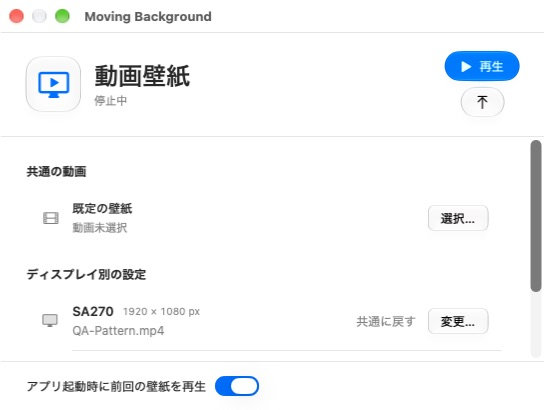

# Moving Background

[English](../README.md) · [日本語](README.ja.md) · [繁體中文](README.zh-Hant.md)

手元のMP4を、無音で繰り返し再生するデスクトップ壁紙にできます。Macではディスプレイごとに別の動画を指定でき、デスクトップが隠れると自動で一時停止します。

[GitHub Releasesからダウンロード](https://github.com/Hamzimer/MP4-Moving-Background/releases/latest)

## 主な機能

| | macOS | Windowsプレビュー |
| --- | --- | --- |
| 操作 | メニューバーと設定ウインドウ | 通知領域 |
| ディスプレイ | 共通の動画とディスプレイごとの動画を設定 | メインディスプレイ |
| 再生 | 無音ループ。デスクトップが隠れたとき、画面スリープ中、セッションが非アクティブのとき、低電力モード中は一時停止 | 無音ループ。他のアプリが前面にあるときや画面ロック中は一時停止 |
| 表示言語 | 日本語・英語・繁体字中国語 | 日本語・英語・繁体字中国語 |

Mac版は設定画面下部の **表示言語** で切り替えられます。変更はすぐに反映され、次回起動時にも引き継がれます。**システム設定に従う** を選ぶとmacOSの設定に戻ります。Windows版はOSの表示言語に従います。MP4は元の場所から読み込みます。

## インストール

- **macOS 26以降、Apple Silicon・Intel** — [DMG](../dist/Moving-Background-macOS.dmg?raw=true)を開き、アプリを「アプリケーション」へドラッグします。起動後、設定でMP4を選んでください。このビルドはアドホック署名で、Appleの公証は未取得です。
- **Windows 10・11 x64** — [セットアップEXE](../dist/Moving-Background-Windows-x64-Setup.exe?raw=true)を開き、起動後に通知領域からMP4を選びます。.NET Framework 4.xとWPFを使用します。プレビュー版は署名なしで、Windows上でのインストールと再生は未検証です。

[SHA-256チェックサム](../dist/SHA256SUMS.txt) · [不具合の報告](https://github.com/Hamzimer/MP4-Moving-Background/issues)

気に入ったら、GitHubでスターを付けていただけると励みになります。
