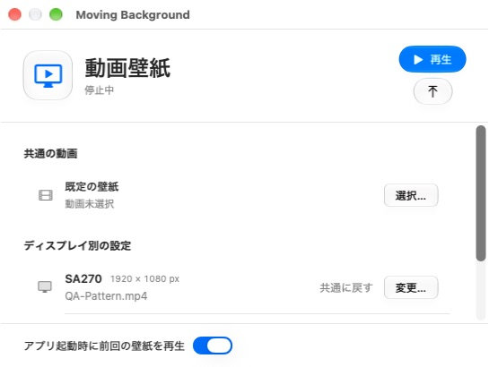

# Moving Background

[English](../README.md) · [日本語](README.ja.md) · [繁體中文](README.zh-Hant.md)

將本機 MP4 設為靜音循環播放的動態桌布。Mac 版可為各個顯示器指定不同影片，桌面被遮蔽時會自動暫停播放。

[從 GitHub Releases 下載](https://github.com/Hamzimer/MP4-Moving-Background/releases/latest)

## 主要功能

| | macOS | Windows 預覽版 |
| --- | --- | --- |
| 操作 | 選單列與設定視窗 | 通知區域 |
| 顯示器 | 可設定預設影片，並為各顯示器個別選擇影片 | 主要顯示器 |
| 播放 | 靜音循環。桌面被遮蔽、顯示器進入睡眠、工作階段非使用中或開啟低耗電模式時暫停 | 靜音循環。其他應用程式位於前景或鎖定畫面時暫停 |
| 介面語言 | 繁體中文、日文、英文 | 繁體中文、日文、英文 |

Mac 版可在設定視窗下方的 **顯示語言** 選擇語言。變更會立即套用，並保留至下次啟動。選擇 **跟隨系統設定** 即可使用 macOS 的顯示語言。Windows 版會跟隨系統的顯示語言。MP4 影片會保留在原本的位置。

## 安裝

- **macOS 26 以上，支援 Apple Silicon 與 Intel** — 開啟 [DMG](../dist/Moving-Background-macOS.dmg?raw=true)，把應用程式拖曳至「應用程式」資料夾，再從設定選擇 MP4。此版本使用臨時簽署，尚未通過 Apple 公證。
- **Windows 10 或 11 x64** — 開啟[安裝程式](../dist/Moving-Background-Windows-x64-Setup.exe?raw=true)，啟動後從通知區域選擇 MP4。需要 .NET Framework 4.x 與 WPF。此預覽版尚未簽署，也尚未在 Windows 上實測安裝與播放。

[SHA-256 校驗碼](../dist/SHA256SUMS.txt) · [回報問題](https://github.com/Hamzimer/MP4-Moving-Background/issues)

如果這個應用程式對你有幫助，歡迎在 GitHub 加上星號。
